<div align="center">

<picture>
  <source media="(prefers-color-scheme: dark)" srcset=".github/assets/banner-dark.svg">
  
</picture>

**Declarative maps backed by real platform map views.**<br>
Control cameras, markers, overlays and interactions through bounded PHP state while panning and rendering remain native.

[](https://packagist.org/packages/pushinbr/pam-native-maps)
[](https://github.com/push-in/pam-native-maps/releases/latest)

[](https://github.com/push-in/pam-native-maps/actions/workflows/ci.yml)
[](LICENSE)

[Install](#install) · [Quick example](#quick-example) · [Platforms](#platform-support) · [Permissions](#requirements) · [API](#api-guide) · [Issues](https://github.com/push-in/pam-native-maps/issues)

</div>

<a id="install"></a>
## <picture></picture> Install

Inside a PAM Native project, add only this capability:

```sh
pam composer require pushinbr/pam-native-maps
pam doctor --fix
```

New to PAM? Follow the [five-minute PAM Native setup](https://push-in.github.io/pam-docs/native/overview/) once (`pam init my-app --template native`), then come back here. Your application stays a normal Composer project with a committed lockfile; `pam composer` runs Composer on PAM's verified PHP runtime, and `pam doctor --fix` refreshes the generated native integration. Use `pam packages` to inspect availability.

<a id="quick-example"></a>
## <picture></picture> Quick example

```php
use Pam\Native\Maps\{Coordinate, MapMarker, MapView};

MapView::make(new Coordinate(-23.5505, -46.6333), 14)
    ->markers([new MapMarker('office', new Coordinate(-23.5505, -46.6333), 'Office')])
    ->showUserLocation();
```

Native Google Maps on Android and MapKit on iOS behind one immutable PHP API. It supports camera control, map styles, up to 5,000 markers, user location, gestures, and typed map, marker, camera and error events.

<a id="platform-support"></a>
## <picture></picture> Platform support

| Platform | Support | Notes |
| --- | --- | --- |
| Android | API 26+ | Google Maps (`play-services-maps` 20.0.0) |
| iOS | 15.0+ | MapKit, CoreLocation |
| PAM Native | 0.8.0 to < 2.0.0 | From `pam-native.plugin.json`; PHP 8.5+ |

<a id="requirements"></a>
## <picture></picture> Permissions and requirements

| Platform | Declared by the plugin |
| --- | --- |
| Android | `android.permission.ACCESS_FINE_LOCATION`, `android.permission.ACCESS_COARSE_LOCATION` (plugin `AndroidManifest.xml`) |
| iOS | `NSLocationWhenInUseUsageDescription` ("Allow this app to show your location on the map.") |

Android apps must provide `com.google.android.geo.API_KEY` in their application manifest. Request location permission at runtime before enabling user location. The package never stores or transmits API keys.

<a id="what-you-can-build"></a>
## <picture></picture> What you can build

- Store locators and delivery tracking
- Travel, mobility and property discovery
- Geospatial dashboards with interactive overlays

| | |
| --- | --- |
| **Best for** | A focused capability you can add to any PAM Native application |
| **Native path** | Google Maps · MapKit |
| **Application model** | Composer package + generated native integration |
| **Design rule** | Independent module; no feed, vertical or application template bundled |

The public API is strictly typed for PHP 8.5; expensive or frame-sensitive work stays in Rust or the platform SDK instead of crossing the application boundary every frame.

<a id="api-guide"></a>
## <picture></picture> API guide

| API | Responsibility |
| --- | --- |
| `MapView` | Render a declarative native map and receive typed events. |
| `Coordinate` | Represent validated latitude and longitude. |
| `MapMarker` | Describe stable marker identity and presentation. |
| `MapStyle` | Select the platform-normalized map style (`Standard`, `Satellite`, `Hybrid`, `Terrain`). |
| `MapEventKind` | Handle `Ready`, `CameraIdle`, `MarkerPress`, `MapPress` and `Error` events. |

All coded states, kinds and variants are sequential integer-backed enums. Use enum cases in application code; do not depend on raw wire numbers.

<a id="production-rules"></a>
## <picture></picture> Production checklist

- Keep marker identifiers stable so reconciliation can update instead of recreate.
- Request location permission before enabling user location.
- Restrict and rotate the Android Maps API key using application and API restrictions.
- Run `pam doctor`, `pam test` and a signed release build on every supported platform.
- Exercise denial, cancellation, backgrounding, process restart and offline behavior before release.

Platform SDKs, credentials, entitlements, physical hardware and store configuration remain application responsibilities.

<a id="troubleshooting"></a>
## <picture></picture> Troubleshooting

- **Android map is blank:** verify the manifest API key, billing and key restrictions.
- **User location is absent:** confirm runtime permission before enabling it.
- **Large marker updates stutter:** preserve IDs and batch state changes.
- **Native integration is stale:** run `pam doctor --fix`, rebuild the native host and inspect the first reported diagnostic.

<a id="docs"></a>
## <picture></picture> Docs

- [PAM Native overview](https://push-in.github.io/pam-docs/native/overview/)
- [Plugin and native capability model](https://push-in.github.io/pam-docs/native/plugins/)
- [PAM documentation](https://push-in.github.io/pam-docs/introduction/)
- [Changelog](CHANGELOG.md)
- [Report an issue](https://github.com/push-in/pam-native-maps/issues): security vulnerabilities go through the repository security policy or GitHub private vulnerability reporting, not a public issue

<a id="pam-ecosystem"></a>
## <picture></picture> Part of the PAM ecosystem

PAM runs PHP natively on servers, desktops and phones. This repository is one piece of it.

| [**PAM**](https://github.com/push-in/pam) | [**PAM Desktop**](https://github.com/push-in/pam-desktop) | [**PAM Native**](https://github.com/push-in/pam-native) | [**Ecosystem**](https://github.com/push-in/pam#ecosystem) |
| --- | --- | --- | --- |
| the runtime and CLI | native desktop apps in PHP | native Android and iOS apps in PHP | every official package and plugin |

<sub>Docs: [push-in.github.io/pam-docs](https://push-in.github.io/pam-docs/introduction/) · [Issues](https://github.com/push-in/pam-native-maps/issues)</sub>

<p align="center"><sub><a href="LICENSE">Apache License 2.0</a> · Made in Brazil by Pushin</sub></p>
